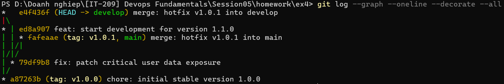

# Bài 4: Mô phỏng quy trình Hotfix & Gitflow thực tế

## 1. Mục tiêu

Thực hành quy trình Gitflow với các nhánh `main`, `develop` và `hotfix`, mô phỏng việc xử lý lỗi nghiêm trọng trên phiên bản production đang chạy.

## 2. Quy trình thực hiện

- `main`: chứa phiên bản production ổn định.
- `develop`: chứa code đang phát triển cho phiên bản tiếp theo.
- `hotfix/v1.0.1`: nhánh sửa lỗi khẩn cấp, được tạo trực tiếp từ `main`.

Quy trình thực hiện:

1. Khởi tạo phiên bản ổn định `v1.0.0` trên `main`.
2. Tạo nhánh `develop` và bắt đầu phát triển phiên bản `1.1.0`.
3. Khi phát hiện lỗi nghiêm trọng trên production, tạo nhánh `hotfix/v1.0.1` trực tiếp từ `main`.
4. Sửa lỗi bảo mật trên nhánh `hotfix/v1.0.1`.
5. Merge nhánh hotfix vào `main`.
6. Tạo tag `v1.0.1` cho phiên bản đã sửa lỗi.
7. Merge nhánh hotfix ngược lại vào `develop`.
8. Xóa nhánh hotfix sau khi hoàn thành.

## 3. Sơ đồ phân nhánh

```text
                         hotfix/v1.0.1
                              │
                              ▼
v1.0.0 ────────────────────► fix
  │                           │
  │                           ├────────► merge vào main
  │                           │              │
  │                           │          tag v1.0.1
  │                           │
  └────────► develop ◄────────┘
                │
                ▼
          version 1.1.0
```

## 4. Các lệnh Git chính

```bash
git checkout main
git checkout -b hotfix/v1.0.1

git add .
git commit -m "fix: patch critical user data exposure"

git checkout main
git merge --no-ff hotfix/v1.0.1 -m "merge: hotfix v1.0.1 into main"

git tag -a v1.0.1 -m "Release Hotfix 1.0.1"

git checkout develop
git merge --no-ff hotfix/v1.0.1 -m "merge: hotfix v1.0.1 into develop"

git branch -d hotfix/v1.0.1
```

## 5. Kiểm tra kết quả

Kiểm tra branch:

```bash
git branch -a
```

Kết quả:

```text
* develop
  main
```

Kiểm tra tag:

```bash
git tag
```

Kết quả:

```text
v1.0.0
v1.0.1
```

Kiểm tra lịch sử merge:

```bash
git log --graph --oneline --decorate --all
```

Lịch sử cho thấy commit sửa lỗi `79df9b8` được sử dụng để merge vào cả `main` và `develop`.

Tag `v1.0.1` trỏ tới merge commit `fafeaae` trên `main`.

## 6. Kết quả

Phiên bản production `v1.0.0` được sửa lỗi khẩn cấp thành `v1.0.1` mà không cần chờ các tính năng chưa hoàn thành trên `develop`.

Sau khi hotfix được merge vào `main`, bản vá cũng được merge ngược vào `develop`, đảm bảo lỗi bảo mật không bị xuất hiện lại trong phiên bản phát triển tiếp theo.

Nhánh `hotfix/v1.0.1` được xóa sau khi hoàn thành việc tích hợp.


